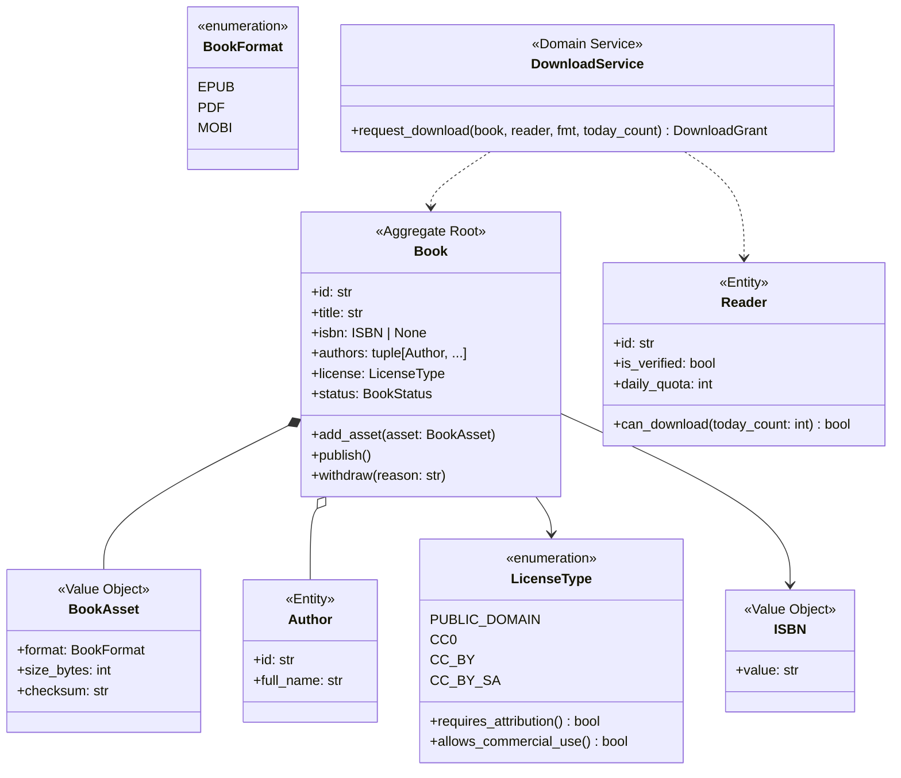

# Учебный стенд `books-api`: два трека — OpenCode V2 и `jcode`

Этот репозиторий — компактный тренировочный полигон для освоения harness-сред coding-агентов. Здесь есть **два самостоятельных курса** по 10 практических уроков каждый, построенных на одной и той же доменной задаче, но демонстрирующих разные архитектуры агентов.

---

## Главный принцип стенда

1. **Стартовое состояние репозитория чистое.** В `src/books_api/` сейчас лежит только заглушка `__init__.py`, а папки `.opencode/` / `.jcode/` и `justfile` ещё нет. Все проектные настройки, конвейер проверок (`ruff`, `ty`, `pytest`), скиллы, MCP-конфиги, плагины, хуки и модули домена вы создаёте по ходу уроков вместе с агентом.
2. **Домен намеренно компактный, а контур качества строгий.** Мы пишем только чистый Domain Layer на стандартной библиотеке Python 3.14 (`dataclasses`, `enum`, `typing.Protocol`), проверяем его максимально строгими и непротиворечивыми правилами `ruff` и `ty` и покрываем быстрыми тестами на `pytest` (через единые команды `just check` и `just test`). Никаких ORM, SQL и веб-серверов: фокус курсов направлен на мастерство управления агентом и замкнутую обратную связь, а не на инфраструктурный бойлерплейт.
3. **Каждую фичу проверяем глазами.** В каждом уроке обоих курсов есть блок самопроверки, чтобы вы точно понимали, как harness устроен под капотом.

---

## Два трека

| | [OpenCode V2](opencode-lessons/README.md) | [`jcode`](jcode-lessons/README.md) |
|---|---|---|
| **Философия** | Единая декларативная платформа: `opencode.jsonc`, кастомные команды и агенты, permissions/policies, Code Mode, плагины | Специализированные встроенные подсистемы: оверлеи `.jcode/`, графовая память, Swarm, `/autoreview`, Lifecycle Hooks |
| **Контур качества** | `just check` + `just test` + независимый сабагент-ревьюер | `just check` + `just test` + `/review`, `/autoreview`, `/judge` |
| **Параллельность** | Фоновые сабагенты и Git worktrees | Swarm с `todo`-дорожками |
| **Точка входа** | [`tutorial/opencode-lessons/README.md`](opencode-lessons/README.md) | [`tutorial/jcode-lessons/README.md`](jcode-lessons/README.md) |

Курсы **не являются зеркальными копиями друг друга**: каждый выстроен от естественного workflow своей harness-среды. Общие элементы — цель (освоить harness-среду на реальной задаче), домен `books-api`, строгий контур `just check` / `just test` и формат уроков (*Цель → Теория-минимум → Практика → Самопроверка → Шпаргалка*).

---

## Целевая доменная область `books-api`

За 10 уроков любого трека в пакете `src/books_api/domain/` вырастет аккуратная модель каталога свободных электронных книг:

---

## Как проходить

- Выберите **один трек** и пройдите его в отдельной ветке Git (`git switch -c track/opencode` или `git switch -c track/jcode`), начиная с чистого стартового состояния репозитория.
- Идите строго от **Урока 01** к **Уроку 10** выбранного трека: каждый следующий урок опирается на код `books-api` и настройки проекта, созданные в предыдущем.
- Не бойтесь экспериментировать с формулировками промптов: примеры промптов в уроках даны как ориентир, а команды `just check` и `just test` в конце каждого урока гарантируют, что ваш домен безупречно типизирован, отформатирован и остаётся в рабочем состоянии.
- В конце каждого урока фиксируйте прогресс коммитом, чтобы в любой момент видеть чистый `git diff` следующего шага.
