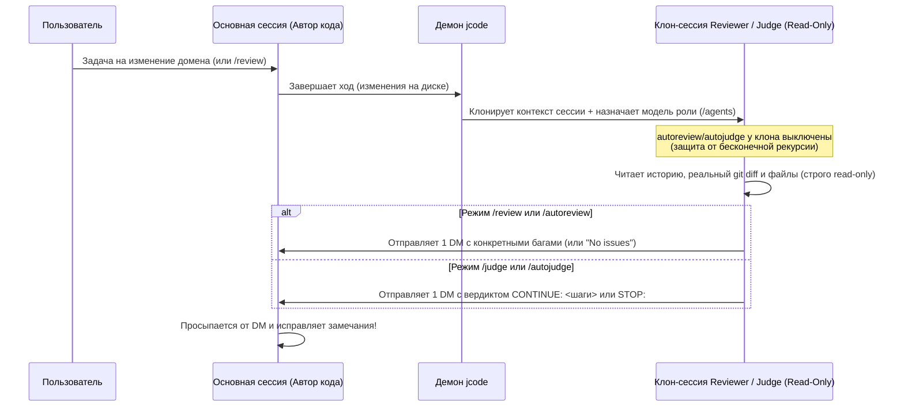

# Урок 08. Глубокое ревью и контроль завершения: `/review`, `/autoreview`, `/judge`, `/agents`

[← Урок 07. Параллельная разработка со Swarm](07-parallel-swarm.md) | [Карта курса](README.md) | [Урок 09. Lifecycle Hooks и автономные циклы `/poke`, `/improve`, `/refactor` →](09-hooks-and-autonomous-loops.md)

## Цель урока

- Досконально разобраться во встроенном независимом контуре качества `jcode`:
  - одноразовом и автоматическом код-ревью (**`/review`** и **`/autoreview`**);
  - одноразовом и автоматическом судье завершения (**`/judge`** и **`/autojudge`**).
- Научиться настраивать **кросс-модельную проверку** через **`/agents`** (и секции `[autoreview]` / `[autojudge]` в `~/.jcode/config.toml`), чтобы код одной модели проверяла совершенно другая модель.
- Провести боевой аудит всего написанного домена `books-api`, отработать автоматический перехват тонкого бага через `/autoreview on` и дожим неполной задачи через `/autojudge on`.

---

## Теория-минимум: как устроены Review и Judge под капотом

Когда один и тот же агент сначала пишет код, а затем в том же окне отвечает на вопрос «проверь себя, всё ли хорошо?», у него срабатывает инерция собственного решения. В `jcode` эта проблема решена архитектурно: **проверка вынесена в независимую дочернюю сессию с жёсткими read-only ограничениями**.



### В чём разница между Reviewer и Judge

| Механизм | Команды запуска | Главный вопрос агента-проверяющего | Что отправляет родителю в DM |
|---|---|---|---|
| **Code Reviewer** | `/review` (разово)<br/>`/autoreview [status\|show\|on\|off\|now]` | *«Есть ли в реальном diff и затронутом коде баги, регрессии, дыры в инвариантах или пропущенные краевые случаи?»* | Список конкретных дефектов с файлами и строками (либо подтверждение, что проблем нет) |
| **Completion Judge** | `/judge` (разово)<br/>`/autojudge [status\|show\|on\|off\|now]` | *«Действительно ли все требования пользователя и критерии качества доведены до конца, или агент остановился слишком рано?»* | Строгий управляющий вердикт **`CONTINUE:`** со списком оставшихся шагов (по умолчанию, пока всё не закрыто) либо **`STOP:`**, когда цель полностью достигнута |

> **Важная деталь синтаксиса:** команды `/review` и `/judge` вызываются **без аргументов** (лишний текст после `/review` вернёт подсказку `Usage: /review`). Они сразу клонируют текущую сессию и запускают проверяющего (открывая его в отдельном окне терминала, если доступно, либо подсказывая команду подключения). А у `/autoreview` и `/autojudge` есть удобный аргумент **`now`** (`/autoreview now`), который немедленно запускает проверку в любой момент, даже если авторежим выключен.

### Кросс-модельная маршрутизация через `/agents`

Самый мощный приём в `jcode`: поставить автором кода одну модель (например, Claude), а на роль `review` и `judge` назначить сильную модель другого семейства (например, GPT от OpenAI, или наоборот). Разные семейства моделей ошибаются по-разному и блестяще ловят слепые пятна друг друга!

Управление ролями выполняется командой `/agents`:

```text
/agents                                      # показать все текущие роли, дефолты и доступные модели
/agents review <model>                       # переопределить модель ревьюера для ЭТОЙ сессии
/agents judge <model>                        # переопределить модель судьи для ЭТОЙ сессии
/agents review inherit                       # сбросить переопределение сессии к дефолту
/agents global review <model|inherit>        # сохранить глобальный дефолт роли в конфиге
```

В глобальном `~/.jcode/config.toml` дефолтные модели этих ролей хранятся в таблицах `[autoreview]` и `[autojudge]` (ключ `model`), а если выбор явно не задан и подключён OpenAI OAuth, разовый `/review` автоматически предпочитает свежую старшую модель OpenAI.

---

## Практика шаг за шагом

### Шаг 1. Настройте ролевые модели через `/agents`

Откройте в TUI список доступных моделей и текущую политику ролей:

```text
/agents
```

Посмотрите, какие модели и провайдеры подключены у вас (`jcode model list` во втором терминале покажет полный каталог). Если у вас доступно два разных модельных ряда или более старшая reasoning-модель, назначьте её на роль `review` и `judge` в текущей сессии (подставьте реальное имя модели из вывода `/agents`):

```text
/agents review <ИМЯ_МОДЕЛИ_ДЛЯ_РЕВЬЮ>
/agents judge <ИМЯ_МОДЕЛИ_ДЛЯ_СУДЬИ>
/agents status
```

Если у вас подключён один провайдер, вы можете либо выбрать его самую сильную модель, либо оставить `inherit`: за счёт отдельной чистой read-only сессии и специализированного промпта ревьюера независимая проверка всё равно работает намного острее самопроверки.

### Шаг 2. Запустите разовое глубокое ревью `/review` по всему домену

Убедитесь, что в текущей сессии есть контекст нашей работы над `books-api` (при необходимости попросите агента кратко просмотреть `src/books_api/domain/`), и введите ровно:

```text
/review
```

Понаблюдайте за происходящим:

1. `jcode` клонирует сессию и поднимает read-only ревьюера (если у вас графическое окружение с поддерживаемым терминалом, вы увидите окно ревьюера вживую; также за дочерними сессиями всегда можно следить через `/observe`).
2. Ревьюер изучает код и тесты `books-api`, находит тонкие места (например, сравнение наивных и timezone-aware `datetime` в `BookDownloaded`, регистрозависимость `book_id` в `downloaded_today`, дубликаты авторов с одинаковым `id` в `Book` или поведение `resolve_anthology_license` при смешении `PUBLIC_DOMAIN` и `CC0`) и **присылает прямое сообщение (DM) обратно в вашу основную сессию**.
3. Ваша основная сессия получает отчёт ревьюера и сразу может исправить найденные замечания!

### Шаг 3. Включите `/autoreview on` и поймайте скрытый доменный баг на лету

Теперь протестируем автоматический контур, который страхует каждый ваш ход. Включите авторевью для текущей сессии:

```text
/autoreview on
/autoreview status
```

Поручим основному агенту добавить в каталог новую фичу со слегка провокационной формулировкой, где легко допустить тонкую ошибку граничного случая:

```text
Добавь в `DownloadService` метод пакетной выдачи архива форматов одной книги `request_bundle(book: Book, reader: Reader, formats: Sequence[BookFormat], downloaded_today: Collection[str], now: datetime) -> tuple[DownloadGrant, ...]`, который выдаёт гранты сразу на несколько запрошенных форматов книги и покрывается базовым тестом.
```

Дождитесь окончания хода основного агента. Как только он отрапортует о готовности, **автоматически запустится `autoreview`**:

- Ревьюер проверит свежий diff: например, что будет, если `formats` пустой? Что если в `formats` передали `["EPUB", "EPUB"]` (два одинаковых формата)? Не съест ли второй формат в том же вызове `request_bundle` лишнюю единицу суточной квоты читателя, если `downloaded_today` не обновился между итерациями цикла?!
- Отчёт ревьюера прилетит в родительскую сессию по DM, и основной агент тут же закроет все найденные краевые случаи и допишет тесты!

### Шаг 4. Испытайте `/judge` (и `/autojudge`) как контролёра полноты

Проверим второй инструмент контроля качества: судью завершения. Введите:

```text
/judge
```

Судья проанализирует исходный запрос, состояние кода, тестовое покрытие и статус задач и отправит в родительскую сессию вердикт:
- **`CONTINUE: ...`**, если осталась хотя бы одна недоделка (например, забыли экспортировать новый метод/тип или не прогнали `just check` и `just test` после фиксов);
- **`STOP: ...`**, когда все требования и проверки реально закрыты.

Если вы делаете большую многоходовую фичу и хотите, чтобы агент не останавливался на полпути без вашего участия, включайте связку:

```text
/autojudge on
```

А после завершения тяжёлого этапа выключите автоматические триггеры, чтобы не тратить лишние токены на простых вопросах:

```text
/autoreview off
/autojudge off
```

Закоммитьте проверенный и отполированный код:

```text
/commit
```

---

## Самопроверка

Проверьте статус настроек в TUI и тесты в терминале:

```text
/autoreview status
/autojudge status
/agents
```

```bash
just check
just test -v
```

Чеклист результата:

- [ ] Вы проверили таблицу ролевых моделей через `/agents` и умеете назначать отдельную модель на `review` и `judge`.
- [ ] Разовый `/review` и автоматический `/autoreview on` отработали на коде `books-api` и прислали разбор в основную сессию через DM.
- [ ] Метод `request_bundle` в `DownloadService` корректно обрабатывает пустой список форматов, дубликаты форматов и не списывает суточную квоту дважды за одну книгу.
- [ ] Вы проверили работу `/judge` и отключили `/autoreview off` и `/autojudge off` перед следующим уроком.

---

## Шпаргалка урока

| Команда | Назначение |
|---|---|
| `/review` | Разовый запуск независимого read-only код-ревьюера (без аргументов) |
| `/autoreview [status\|show\|on\|off\|now]` | Управление авто-ревью в конце каждого хода сессии (`now` запускает немедленно) |
| `/judge` | Разовый запуск судьи полноты завершения работы (`CONTINUE:` / `STOP:`) |
| `/autojudge [status\|show\|on\|off\|now]` | Управление автоматическим контролем завершения в конце хода |
| `/agents` | Показать модели по ролям (`swarm`, `review`, `judge`, `memory`, `ambient`) |
| `/agents [global] <role> <model\|inherit>` | Задать сессионную или глобальную модель для выбранной роли |

Следующий шаг: **[Урок 09. Lifecycle Hooks и автономные циклы `/poke`, `/improve`, `/refactor` →](09-hooks-and-autonomous-loops.md)**
