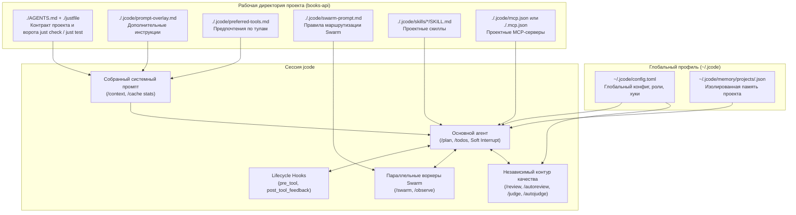
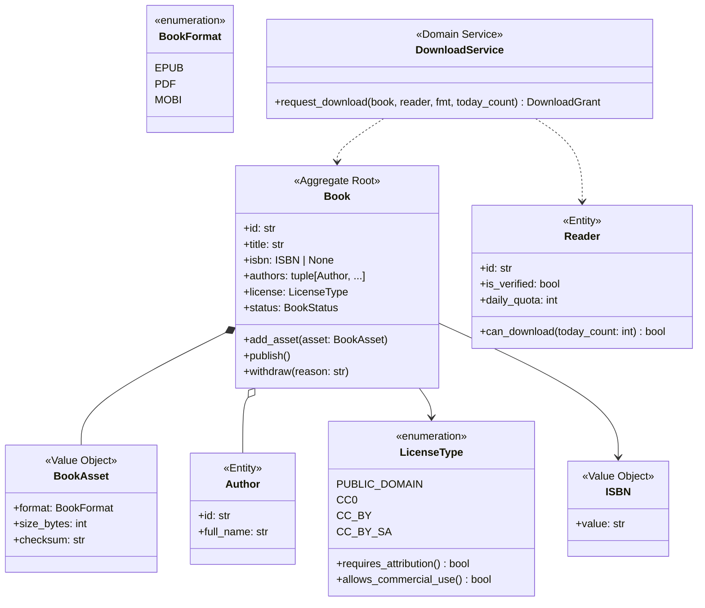

# Практический курс по `jcode`: от `AGENTS.md` до автономного ревью и Swarm

> [← К выбору трека и карте стенда](../README.md)

Этот курс состоит из **10 практических уроков**. Проходя их по порядку, вы освоите повседневные и продвинутые инструменты `jcode`, а также все ключевые **настройки уровня проекта**.

В качестве тренировочного полигона мы с нуля построим доменное ядро учебного проекта **`books-api`** (каталог легальной бесплатной раздачи книг в открытом достоянии и под свободными лицензиями Creative Commons).

---

## Главный принцип курса

1. **Стартовое состояние репозитория чистое.** В `src/books_api/` сейчас лежит только заглушка `__init__.py`, а папки `.jcode/` и `justfile` ещё нет. Все проектные настройки, конвейер проверок (`ruff`, `ty`, `pytest`), скиллы, MCP-конфиги, хуки и модули домена вы создаёте по ходу уроков вместе с `jcode`.
2. **Домен намеренно компактный, а контур качества строгий.** Мы пишем только чистый Domain Layer на стандартной библиотеке Python 3.14 (`dataclasses`, `enum`, `typing.Protocol`), проверяем его максимально строгими и непротиворечивыми правилами `ruff` и `ty` и покрываем быстрыми тестами на `pytest` (через единые команды `just check` и `just test`). Никаких ORM, SQL и веб-серверов: фокус курса направлен на мастерство управления агентом и замкнутую обратную связь, а не на инфраструктурный бойлерплейт.
3. **Каждую фичу проверяем глазами.** В каждом уроке есть блок самопроверки через встроенные команды диагностики (`/context`, `/info`, `/cache stats`, `/skills`, `/agents`, `jcode mcp test`, `jcode memory list`), чтобы вы точно понимали, как `jcode` устроен под капотом.

---

## Требования к окружению

Перед стартом проверьте в терминале:

```bash
jcode version          # jcode v1.0+ с настроенным провайдером (jcode auth status)
uv --version           # менеджер окружения и пакетов Python
just --version         # раннер команд проекта (just check / just test)
python3 --version      # Python 3.14+
```

> **Совет:** держите открытыми два окна или две панели терминала в директории `books-api`. В первом окне у вас будет жить интерактивная TUI-сессия `jcode`, а во втором удобно запускать диагностические CLI-команды (`jcode memory ...`, `jcode mcp ...`, `git status`) и читать текст текущего урока.
> Либо попросите сам `jcode` открыть нужный урок в боковой панели командой: `Открой tutorial/jcode-lessons/01-project-contract-and-context.md в панели`.

---

## Как `jcode` собирает настройки вокруг вашего проекта

В `jcode` чётко разделены **статические слои системного промпта** (дружелюбные к prompt-кэшу провайдера), **динамические расширения** (память, скиллы, MCP), **координация сабагентов** (Swarm, Review, Judge) и **перехватчики среды выполнения** (Lifecycle Hooks).



> **Важная деталь архитектуры `jcode`:** файл `config.toml` загружается глобально из `~/.jcode/config.toml` (или `$JCODE_HOME/config.toml`). При этом поведение внутри конкретного репозитория гибко настраивается через файлы в корне проекта (`AGENTS.md`, `.jcode/prompt-overlay.md`, `.jcode/preferred-tools.md`, `.jcode/system-prompt.md`, `.jcode/swarm-prompt.md`, `.jcode/skills/`, `.jcode/mcp.json`), изолированную проектную память и переменные окружения `JCODE_HOOK_*`. В уроках мы разберём каждый из этих механизмов на практике.

---

## Целевая доменная область `books-api`

За 10 уроков в пакете `src/books_api/domain/` вырастет аккуратная модель каталога свободных электронных книг:



---

## Программа курса (10 уроков)

### Блок I. Конфигурация промпта, контекст и управление ходом

| № | Урок | Фичи и настройки `jcode` | Что создаём в `books-api` |
|---|---|---|---|
| **01** | [Контракт проекта в `AGENTS.md` и инспекция контекста](01-project-contract-and-context.md) | Запуск TUI, `/help`, `/model`, `/info`, `/context`, `/git`, слои промпта, корневой `./AGENTS.md`, `/commit` | Настройка строгих `ruff`, `ty` и `pytest` в `pyproject.toml`, создание `justfile` (`just check`, `just test`), иерархия `DomainError` |

| **02** | [Проектные оверлеи `.jcode/` и работа с prompt-кэшем](02-prompt-overlays-and-cache.md) | `.jcode/prompt-overlay.md`, `.jcode/preferred-tools.md`, `.jcode/system-prompt.md`, `/cache stats`, `/fast`, `/effort` | Value Objects: `ISBN`, `BookFormat`, `LanguageCode`, `LicenseType` и их юнит-тесты |
| **03** | [Планирование `/plan`, трекинг `/todos` и управление ходом на лету](03-planning-todos-and-flow-control.md) | `/plan`, `/todos`, *Soft Interrupt* (инъекция без отмены стрима), боковая ветка `/btw`, откат `/rewind` | Сущности `Author`, `BookAsset` и агрегат `Book` с жизненным циклом публикации и отзыва |

### Блок II. Долговременные знания и расширяемость проекта

| № | Урок | Фичи и настройки `jcode` | Что создаём в `books-api` |
|---|---|---|---|
| **04** | [Проектная память и управление сессиями](04-project-memory-and-sessions.md) | Инструмент `memory` (`project` vs `global`), `/memory`, CLI `jcode memory`, `/save`, `/resume`, `jcode session rename`, `/compact` | Сущность `Reader`, политика дневных антибот-квот скачивания и фиксация решений в памяти проекта |
| **05** | [Собственные проектные скиллы в `.jcode/skills/`](05-project-skills.md) | Структура `.jcode/skills/<name>/SKILL.md`, YAML frontmatter, `/skills`, ручной и автоматический вызов скилла | Скилл `/domain-invariants` и расширение граничных инвариантов и тестов для `Book` и `Reader` |
| **06** | [Проектный MCP-сервер в `.jcode/mcp.json`](06-project-mcp-server.md) | `.jcode/mcp.json` и `.mcp.json`, подстановка `${VAR}`, `jcode mcp list`, `jcode mcp test`, вызов MCP из чата | Локальный stdio MCP-сервер справочника свободных лицензий (`tools/license_mcp.py`) и модуль `LicensePolicy` |

### Блок III. Мультиагентность, независимое ревью и перехватчики

| № | Урок | Фичи и настройки `jcode` | Что создаём в `books-api` |
|---|---|---|---|
| **07** | [Параллельная разработка со Swarm](07-parallel-swarm.md) | `/swarm`, `.jcode/swarm-prompt.md` (`/swarm-prompt`), параллельные дорожки `todo`, `/observe`, `/splitview`, `/subagent-model` | Параллельная разработка `DownloadService` (гранты и события) и поиска по каталогу (`CatalogQuery` + `InMemoryBookRepository`) |
| **08** | [Глубокое ревью и контроль завершения: `/review`, `/autoreview`, `/judge`, `/agents`](08-review-autoreview-and-judge.md) | Одноразовый и автоматический ревьюер (`/review`, `/autoreview`), судья завершения (`/judge`, `/autojudge`), кросс-модельная маршрутизация ролей через `/agents` | Независимый аудит всего доменного слоя другой моделью, отлов тонких краевых багов мутабельности и квот |
| **09** | [Lifecycle Hooks и автономные циклы `/poke`, `/improve`, `/refactor`](09-hooks-and-autonomous-loops.md) | `pre_tool` (код блокировки `2`), `post_tool_feedback`, `JCODE_HOOK_*`, `todo_gate_digest`, `/poke`, `/improve`, `/refactor` | Скрипты защиты чистоты домена и автопрогона `just check` + `just test`, пакетный рефакторинг публичного фасада `books_api.domain` |

### Блок IV. Автоматизация, песочницы и визуализация

| № | Урок | Фичи и настройки `jcode` | Что создаём в `books-api` |
|---|---|---|---|
| **10** | [Неинтерактивный CLI `jcode run`, песочницы инструментов и живые панели](10-headless-sandboxes-and-panels.md) | `jcode --quiet run`, `--json`, `--ndjson`, `--tool-profile`, `--tools`, `--disabled-tools`, инструмент `panel` | Безопасный read-only скрипт проверки архитектуры домена, карта домена с `mermaid` в `docs/domain-map.md` и рендеринг в панели |

---

## Как проходить уроки

- Идите строго от **Урока 01** к **Уроку 10**: каждый следующий урок опирается на код `books-api` и настройки проекта, созданные в предыдущем.
- Не бойтесь экспериментировать с формулировками промптов: примеры промптов в уроках даны как ориентир, а команды `just check` и `just test` в конце каждого урока гарантируют, что ваш домен безупречно типизирован, отформатирован и остаётся в рабочем состоянии.
- В конце каждого урока фиксируйте прогресс коммитом (вручную или командой `/commit` внутри `jcode`), чтобы в любой момент видеть чистый `git diff` следующего шага.

Готовы? Переходите к **[Уроку 01: Контракт проекта в `AGENTS.md` и инспекция контекста](01-project-contract-and-context.md)**.
