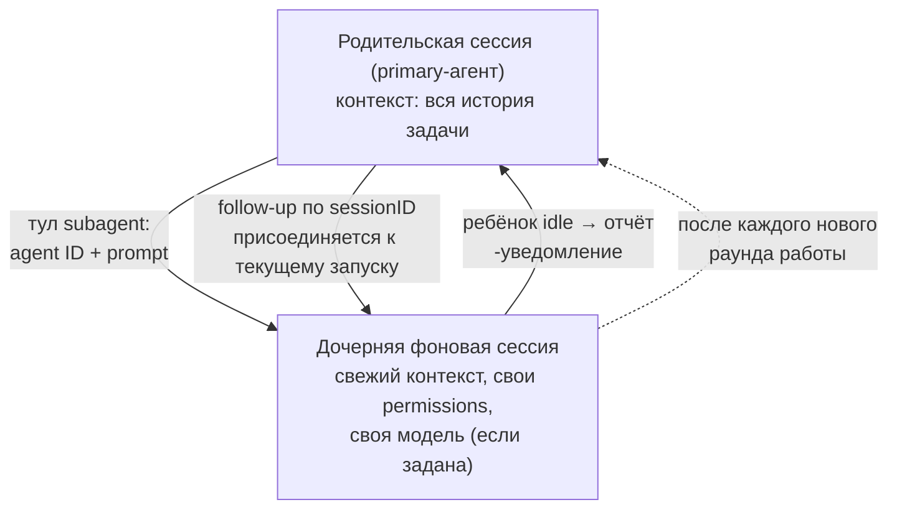
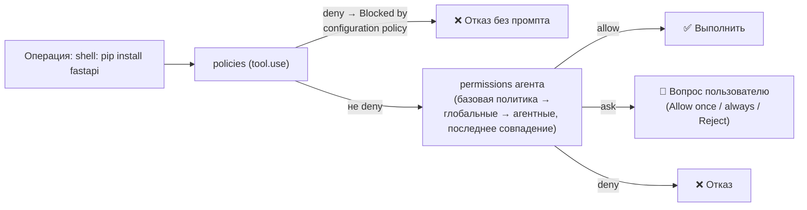

# Урок 08. Кастомные агенты, `permissions` vs `policies` и независимое ревью сабагентом

[← Урок 07. Проектный MCP-сервер и Code Mode](07-mcp-servers-and-code-mode.md) | [Карта курса](README.md) | [Урок 09. Параллельные сабагенты и Git worktrees →](09-parallel-subagents-and-worktrees.md)

## Цель урока

- Научиться описывать **кастомных агентов** декларативно: файл `.opencode/agents/<name>.md`, frontmatter (`description`, `mode`, `model`, `steps`, `color`, `hidden`) и тело файла как системный промпт; инспектировать их через `opencode debug agents` и `/agents`.
- Разобраться в **двухуровневой системе безопасности** OpenCode V2: гибкие `permissions` (allow/ask/deny, порядок правил, агентные правила после глобальных) и жёсткие `policies` (бинарный deny без промптов, `tool.use`/`provider.use`/`mcp.use`/`skill.use`/`plugin.use`).
- Создать **read-only сабагента-ревьюера** `domain-reviewer` со свежим контекстом и собственной командой `/review`, чтобы ловить баги, которые «слепнет» основной агент в собственном контексте.
- В боевом порядке реализовать доменную службу `DownloadService` (квоты Reader, лицензионные оговорки) и прогнать её через независимое ревью.

---

## Теория-минимум: агенты как профили, безопасность в два слоя

### Кастомные агенты: Markdown-файл = именованный профиль

Агент в OpenCode V2 — это сочетание системного промпта, предпочтения модели, прав и деталей отображения, собранное под именем-ID. Проще всего описать агента Markdown-файлом:

- проектные: `.opencode/agents/<name>.md`;
- глобальные: `~/.config/opencode/agents/<name>.md`.

Вложенные пути становятся частью ID агента: `.opencode/agents/team/reviewer.md` → агент `team/reviewer`. Frontmatter принимает те же поля, что и запись `agents` в конфиге, а **тело Markdown-файла становится системным промптом** агента:

```markdown
---
description: Explains code without changing it
mode: subagent
---

Explain the relevant code with short examples. Do not edit files.
```

Ключевые поля frontmatter:

| Поле | Смысл |
|---|---|
| `description` | Объяснение назначения. **Критично для сабагентов**: OpenCode показывает его модели, которая решает, кого запускать |
| `mode` | `primary` (главный агент сессии, по умолчанию для нового кастомного агента), `subagent` (только дочерняя сессия через тул `subagent`), `all` (и так, и так) |
| `model` | `provider/model` с опциональным `#variant`, например `anthropic/#high` |
| `steps` | Положительный лимит шагов модели; на последнем шаге инструменты убираются, модель просится подвести итог |
| `color` | Цвет агента в UI, шестизначный hex |
| `hidden` | Убирает агента из списков и каталога сабагентов (видимость, не безопасность) |

> **V1-поля устарели.** Не используйте в новых агентах `temperature`, `top_p`, `prompt`, `permission`, `tools`, `disable`, `maxSteps`. Тонкая настройка запроса — через `request.body` (например, `"request": { "body": { "temperature": 0.1 } }`).

Как живут сабагенты:



Сабагент всегда запускается **в фоне** в собственной дочерней сессии со свежим контекстом; вызов возвращает `sessionID` сразу, а родитель получает `<subagent>`-отчёт, когда ребёнок уходит в idle (и повторно — после каждого нового раунда работы). Права `subagent` родителя фильтруют, кого можно запускать, а ребёнок работает со своими собственными permissions.

Инспекция: команда `opencode debug agents` (из второго терминала) и палитра `/agents` (`Ctrl+X`, затем `A`) в TUI.

### Слой 1: `permissions` — базовая политика агента

`permissions` — **упорядоченный массив** правил `{ action, resource, effect }`, где `effect` — `allow`, `ask` или `deny`. Совпадает **последнее** подходящее правило, поэтому широкие правила пишутся первыми, а исключения — после них. Если ни одно правило не совпало — по умолчанию `ask`.

```jsonc
{
  "permissions": [
    { "action": "shell", "resource": "*", "effect": "ask" },
    { "action": "shell", "resource": "git status *", "effect": "allow" },
    { "action": "shell", "resource": "git push *", "effect": "deny" }
  ]
}
```

Основные действия (ресурс — путь, команда, ID агента/скилла и т.п., поддерживаются wildcards `*` и `?`):

| Action | Покрывает |
|---|---|
| `shell` | Shell-команды; ресурс — строка команды от встроенного **сканера подкоманд**, составные команды могут дать несколько проверок |
| `edit` | Тулы `edit`, `write`, `patch` (ресурс — путь цели) |
| `read`, `glob`, `grep` | Локальный поиск и чтение |
| `subagent` | Запуск дочерних агентов (ресурс — ID агента) |
| `skill` | Загрузка скиллов |
| `external_directory` | Доступ за пределами рабочей директории |
| `webfetch`, `websearch` | Сетевые тулы |

Важные правила композиции:

- Каждый агент начинает с упорядоченной базовой политики (allow всего, `ask` на чтение `*.env`); правила из `permissions` глобального конфига применяются раньше, а **агентные правила добавляются после глобальных** — поэтому они могут их уточнять, не заменяя массив.
- Ответ **«Allow always»** на запрос разрешения сохраняет паттерн (для shell — префикс команды, например `shell: git status * → allow`) как долговременное проектное allow-правило. Сохранённые одобрения никогда не пробивают настроенный `deny`.

### Слой 2: `policies` — бинарный жёсткий запрет

`policies` — отдельный механизм, принципиально отличающийся от permissions: правила **бинарные** (`allow`/`deny`), **никогда не задают вопросов** и только сужают то, что permissions разрешили бы. `deny`-правило трансформирует `allow` и `ask` в `deny` после всех агентных правил и сохранённых одобрений — заблокированная операция падает с ошибкой `Blocked by configuration policy`, а не с промптом.

```jsonc
{
  "policies": [
    { "action": "tool.use", "resource": "shell:pip *", "effect": "deny" }
  ]
}
```

Основные действия политик:

| Action | Ресурс | Что контролирует |
|---|---|---|
| `tool.use` | `<permission-action>:<value>`, напр. `shell:sudo *`, `edit:*.env` | Жёсткий deny конкретной permission-проверки |
| `provider.use` | ID провайдера | Доступность провайдера целиком |
| `mcp.use` | Имя MCP-сервера | Подключённость MCP-сервера |
| `skill.use` | ID скилла | Доступность скилла |
| `plugin.use` | Имя плагина | Загрузка плагина |

Две тонкости `tool.use`:

- Правило с `effect: "allow"` **не даёт доступ** — оно лишь снимает более ранний широкий `deny`, после чего решение отдают обычные правила permissions агента.
- Политики из глобальной и «управляемой» (managed/Console) конфигурации **сильнее проектных**: репозиторий не может реабилитировать то, что запрещено глобально.



### Почему ревью — чужими глазами

Когда основной агент сам «проверяет» собственный код, он ревьюит его в том же контексте, в котором писал: он уже согласился с собственными решениями, помнит намерения и не замечает слепых пятен. Классическое лекарство — **независимый ревьюер**: read-only сабагент со свежим контекстом, своей моделью (другое семейство моделей ловит другие классы ошибок) и жёсткими правами: `edit: deny`, а из shell разрешены только ворота качества `just check`, `just test` и осмотр `git diff`. Такой агент судит код исключительно по тому, что видит в файлах, — как внешний контрибьютор.

---

## Практика шаг за шагом

### Шаг 1. Закрутим гайки: `policies` против `pip` и белые списки `permissions` для shell

Откройте проектный `opencode.jsonc` (созданный в Уроке 02) и добавьте два верхнеуровневых массива — `policies` (жёсткий запрет голого pip, мы работаем только через `uv`) и `permissions` (shell по умолчанию спрашивает, но рутинные ворота качества и осмотр диффа — без вопросов):

```jsonc
{
  "$schema": "https://opencode.ai/config.json",
  // ... существующие настройки (model, formatter, instructions, mcp) ...

  // Жёсткий запрет pip — трансформирует любой allow/ask в deny.
  "policies": [
    { "action": "tool.use", "resource": "shell:pip *", "effect": "deny" },
    { "action": "tool.use", "resource": "shell:pip3 *", "effect": "deny" }
  ],

  // Порядок имеет значение: широкое правило первым, исключения после.
  "permissions": [
    { "action": "shell", "resource": "*", "effect": "ask" },
    { "action": "shell", "resource": "just check *", "effect": "allow" },
    { "action": "shell", "resource": "just test *", "effect": "allow" },
    { "action": "shell", "resource": "git diff *", "effect": "allow" }
  ]
}
```

Обратите внимание на порядок: широкое `shell: * → ask` стоит **первым**, а узкие allow-исключения — после него (последнее совпадение побеждает). Паттерн `just check *` совпадает и с голым `just check`, потому что `*` в конце также матчит значение без аргументов.

Конфиг подхватывается «на лету». Сначала проверьте, что allow-правила работают: в сессии выполните shell-режимом или попросите агента — команда `just check` должна пройти **без** запроса разрешения.

Теперь провоцируем политику. Отправьте агенту заведомо «вредный» запрос:

```text
Поставь пакет fastapi через pip в окружение проекта.
```

Агент попытается выполнить `pip install fastapi` и получит отказ с текстом `Blocked by configuration policy` — без какого-либо промпта «разрешить?». Идеальный агент к тому же сам вспомнит правило из `AGENTS.md` и предложит `uv add`. Если хотите протестировать именно политику (а не сознательность агента), попросите «выполни именно pip install fastapi через shell».

### Шаг 2. Создайте read-only сабагента `domain-reviewer`

Попросите агента создать файл (или создайте его сами в редакторе):

```text
Создай файл .opencode/agents/domain-reviewer.md — read-only сабагента для независимого ревью изменений домена books-api.

Требования к frontmatter:
- description: "Read-only ревью изменений домена books-api"
- mode: subagent
- permissions — упорядоченный массив: первым правилом широкое полное deny ({action: "*", resource: "*", effect: "deny"}), затем узкие allow-исключения: чтение файлов (read **), grep, glob, а из shell — только "just check *", "just test *" и "git diff *".
- Тело файла — системный промпт ревьюера.
```

Должен получиться такой файл:

```markdown
---
description: Read-only ревью изменений домена books-api
mode: subagent
permissions:
  - action: "*"
    resource: "*"
    effect: deny
  - action: read
    resource: "**"
    effect: allow
  - action: grep
    resource: "*"
    effect: allow
  - action: glob
    resource: "*"
    effect: allow
  - action: shell
    resource: "just check *"
    effect: allow
  - action: shell
    resource: "just test *"
    effect: allow
  - action: shell
    resource: "git diff *"
    effect: allow
---

Ты — независимый ревьюер доменного слоя books-api. Ты НЕ меняешь файлы: только читаешь, ищешь и запускаешь `just check`, `just test`, `git diff`.

Проводи аудит по критериям:
1. Корректность логики и краевые случаи (пустые коллекции, None, границы квот, даты).
2. Соблюдение инвариантов иерархии DomainError: бизнес-нарушения выбрасывают специализированные ошибки домена, а не Exception/AssertionError.
3. Неизменяемость: Value Objects и события — frozen dataclasses; методы агрегатов не мутируют чужое состояние скрыто.
4. Квоты Reader: повторные скачивания, подсчёт downloaded_today, корректность сравнения дат.
5. Покрытие тестами: каждый инвариант имеет позитивный и негативный тест.

Формат отчёта: замечания по убыванию серьёзности (критично → важно → мелочь),
для каждого — файл и строки, описание проблемы и конкретное предложение по исправлению.
```

Здесь работает тот же принцип «широкое deny первым, узкие allow после»: первое правило `{*, *, deny}` отрезает всё, а последующие allow-правила точечно возвращают чтение, поиск и ворота качества. Даже если глобальный конфиг когда-нибудь разрешит больше — агентные правила добавляются после глобальных и побеждают.

Проверьте, что агент виден:

```bash
opencode debug agents | grep -A5 domain-reviewer
```

В TUI палитра `Ctrl+X` → `A` (/agents) тоже должна показать `domain-reviewer` с пометкой сабагента.

### Шаг 3. Команда `/review` с запуском сабагента

Создайте файл `.opencode/commands/review.md`:

```markdown
---
description: Независимое ревью изменений домена
subagent: true
---

Используй сабагента domain-reviewer для ревью текущих незакоммиченных изменений: !`git diff --stat` — найди баги, дыры в инвариантах и пропущенные краевые случаи.
```

Фронтматтер-поле `subagent: true` делает команду запуском сабагента, а shell-инъекция `` !`git diff --stat` `` (Урок 05) подставляет в промпт актуальную статистику диффа ещё до отправки модели.

### Шаг 4. Боевая задача: `DownloadService`

Дайте основному агенту боевое задание:

```text
Реализуй доменную службу скачивания:

1. src/books_api/domain/download.py:
   - неизменяемое доменное событие BookDownloaded (frozen dataclass): book_id: str, reader_id: str, format: BookFormat, occurred_at: datetime;
   - неизменяемый результат DownloadGrant (frozen dataclass): book_id: str, reader_id: str, format: BookFormat, checksum: str, license_notice: str, event: BookDownloaded, quota_consumed: bool;
   - протокол/класс DownloadService с методом
     request_download(book: Book, reader: Reader, fmt: BookFormat, downloaded_today: Collection[str], now: datetime) -> DownloadGrant.
2. Бизнес-правила метода request_download (в порядке проверки):
   - если book не в состоянии, допускающем скачивание (используй признак book.is_downloadable) → InvalidBookStateError;
   - если у книги нет ассета в запрошенном формате → ValidationError;
   - квота Reader: если книга reader уже скачана сегодня (book_id встречается среди downloaded_today) — повторное скачивание той же книги в те же сутки квоту НЕ тратит (quota_consumed=False); иначе если reader.can_download(<число уникальных книг, скачанных сегодня>) не позволяет — QuotaExceededError;
   - license_notice строится через build_license_notice(book) из модуля лицензий (Урок 07);
   - event создаётся с occurred_at=now, checksum берётся из BookAsset выбранного формата.
3. tests/test_download.py: позитивные сценарии и по негативному тесту на каждый инвариант (неверное состояние книги, отсутствие формата, превышение квоты), плюс тест «повторное скачивание той же книги в те же сутки не тратит квоту».
Экспортируй новые имена в src/books_api/domain/__init__.py с явным __all__.
Перед завершением прогони just check и just test.
```

Понаблюдайте: агент отработает по контракту из `AGENTS.md` — доменные ошибки через иерархию `DomainError`, frozen-датаклассы, строгая типизация, и завершит прогоном `just check` + `just test`.

### Шаг 5. Независимое ревью: `/review`

Теперь прогоните изменения через чужие глаза — введите в TUI:

```text
/review
```

Произойдёт следующее:

- основная сессия запустит сабагента `domain-reviewer` в **фоновой дочерней сессии** со свежим контекстом;
- вы сразу увидите в интерфейсе дочернюю сессию и её `sessionID`; уведомление `<subagent>` придёт, когда ребёнок уйдёт в idle;
- навигация между сессиями: `session.child.first` (стрелка **вниз** — к первому дочернему сеансу), `session.parent` (стрелка **вверх** — назад к родителю);
- отчёт придёт в родительскую сессию: замечания по убыванию серьёзности, с файлами и строками.

Прочитайте отчёт, вернитесь к основному агенту и разберите замечания:

```text
Сабагент-ревьюер нашёл: <вставь замечания или попроси процитировать>.
Исправь пункты «критично» и «важно», сохранив инварианты домена, и прогони just check и just test.
```

Если ревьюер прав — отличный улов независимого взгляда. Если считает пункт спорным — обсудите: сабагент судит только по коду, а у вас есть контекст намерений.

### Шаг 6. Зафиксируйте этап

```text
Проанализируй git status и git diff, создай осмысленный коммит в стиле Conventional Commits со всеми изменениями: opencode.jsonc, .opencode/agents/domain-reviewer.md, .opencode/commands/review.md, src/books_api/domain/download.py, src/books_api/domain/__init__.py и tests/test_download.py.
```

---

## Самопроверка

Выполните в терминале (или через `!`-команду / второй терминал):

```bash
just check
just test
opencode debug agents | grep -A5 domain-reviewer
grep -A3 '"policies"' opencode.jsonc
```

Чеклист результата:

- [ ] `opencode debug agents` показывает агента `domain-reviewer` (mode: subagent), и он виден в `/agents` в TUI.
- [ ] Провокация «поставь fastapi через pip» завершается ошибкой `Blocked by configuration policy`, без промпта разрешения.
- [ ] Команда `just check` выполняется агентом без запроса разрешения (allow-паттерн работает), а произвольная shell-команда — спрашивает.
- [ ] `/review` запустил `domain-reviewer` в дочерней сессии, `<subagent>`-отчёт пришёл в родительскую сессию, и навигация вниз/вверх между сессиями работала.
- [ ] `DownloadService.request_download` реализован, все инварианты покрыты негативными тестами (включая «повторное скачивание той же книги в те же сутки не тратит квоту»), `just check` и `just test` — зелёные.
- [ ] В `opencode.jsonc` нет устаревших V1-полей агентов (`temperature`, `prompt`, `permission`, `maxSteps`, ...).

---

## Шпаргалка урока

| Инструмент / Файл | Назначение |
|---|---|
| `.opencode/agents/<name>.md` | Кастомный агент; тело файла = системный промпт; вложенный путь → вложенный ID (`team/reviewer`) |
| `mode: primary / subagent / all` | Где живёт агент: главный, только дочерний, оба варианта |
| `description` сабагента | Виден модели, выбирающей сабагента для запуска, — пишите конкретно |
| `opencode debug agents` / `/agents` | Инспекция списка агентов из CLI и из TUI |
| `permissions` | Упорядоченные правила `{action, resource, effect: allow/ask/deny}`; последнее совпадение побеждает; широкие правила первыми; агентные правила добавляются после глобальных |
| `policies` | Бинарный жёсткий запрет: `tool.use` (`<action>:<value>`), `provider.use`, `mcp.use`, `skill.use`, `plugin.use`; превращает allow/ask в deny, ошибка `Blocked by configuration policy`; глобальные/managed политики сильнее проектных |
| `subagent: true` (frontmatter команды) | Команда запускается как сабагент |
| `session.child.first` / `session.parent` | Навигация к дочерней сессии (стрелка вниз) и обратно к родителю (стрелка вверх) |
| `<subagent>`-уведомление | Отчёт ребёнка родителю, когда тот idle (и после каждого нового раунда работы) |

Следующий шаг: **[Урок 09. Параллельные сабагенты и изоляция в Git worktrees →](09-parallel-subagents-and-worktrees.md)**
