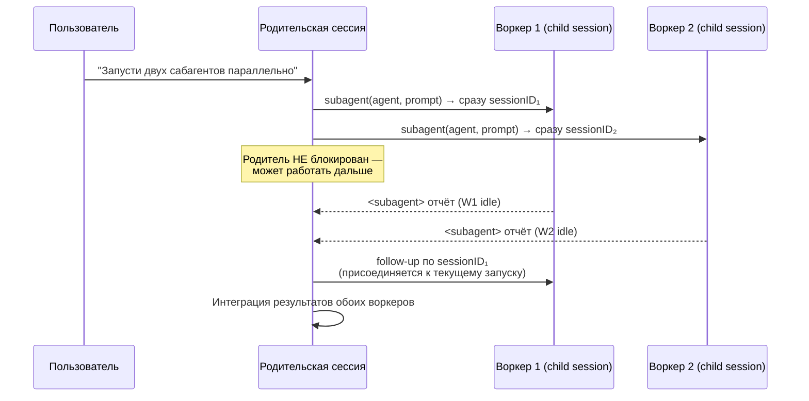

# Урок 09. Параллельные сабагенты и изоляция в Git worktrees

[← Урок 08. Кастомные агенты, permissions/policies и независимое ревью](08-custom-agents-permissions-and-subagent-review.md) | [Карта курса](README.md) | [Урок 10. Плагины, headless CLI, HTTP API и Web UI →](10-plugins-headless-cli-api-and-web.md)

## Цель урока

- Освоить **фоновые параллельные сабагенты** в OpenCode V2: тул `subagent` возвращает `sessionID` немедленно и не блокирует родителя, `<subagent>`-уведомления приходят по мере завершения работы детей, follow-up по `sessionID` присоединяется к текущему запуску.
- Научиться управлять глубиной вложенности через `experimental.subagent_depth` и понимать роль прав `subagent` родителя.
- Освоить **Git worktrees** в OpenCode: настройку `worktree.directory` и утилиты Code Mode `worktree_create` / `worktree_list` / `worktree_remove`, а также перенос сессии в worktree через `session_move`.
- Практически проверить оба сценария: параллельную разработку двух независимых модулей домена (`catalog.py` и `anthology.py`) и изолированный эксперимент с ранжированием поиска в отдельном worktree.

---

## Теория-минимум: фоновые дети и параллельные песочницы

### Как устроены сабагенты в V2

В Уроке 08 мы уже запускали одного сабагента и ждали его отчёта. Теперь посмотрим на механику внимательнее:



Ключевые факты о тулe `subagent`:

- **Всегда фоновый**: вызов возвращает `sessionID` немедленно; родитель может продолжать работу или завершить ход, не дожидаясь ребёнка.
- **Уведомления**: родитель получает `<subagent>`-сообщение, когда ребёнок уходит в idle, и **повторно после каждого нового раунда работы** ребёнка.
- **Follow-up по `sessionID`**: продолжить диалог с тем же ребёнком можно, передав его `sessionID`; follow-up к работающему ребёнку присоединяется к его текущему запуску.
- **Только сабагентные агенты**: запускать можно лишь агентов с `mode: subagent` или `mode: all`.
- **Права родителя**: permission-правило `subagent` родителя фильтрует, каких агентов он может запускать (например, deny всем, allow только `reviewer`).
- **Глубина вложенности**: `experimental.subagent_depth` (по умолчанию `1`) — ребёнок по умолчанию **не может** спавнить собственных сабагентов.

Зачем это нужно на практике:

| Паттерн | Суть |
|---|---|
| Независимые модули / файлы | Разные воркеры пишут непересекающиеся файлы; общий «фасад» (например, `__init__.py`) интегрирует родитель |
| Исследование параллельно с работой | Пока один воркер пишет код, explore-агент изучает кодовую базу или документацию |
| Изоляция рискованных задач | Экспериментальный рефакторинг живёт в отдельной сессии, основная работа не страдает |

**Критичное правило параллельности — не пересекаться по файлам.** Если два воркера редактируют один файл, они затрут изменения друг друга. Поэтому в задачах ниже воркеры получают строго свои файлы, а интеграцию общего `__init__.py` выполняет родитель после получения обоих отчётов.

### Worktrees: изолированная рабочая копия

Git worktree — вторая (третья, ...) рабочая копия того же репозитория на своей ветке. OpenCode умеет управлять ими через Code Mode:

- Настройка `worktree.directory` в `opencode.jsonc` задаёт **родительский каталог** для новых worktrees (OpenCode добавляет к нему имя worktree). Относительный путь резолвится относительно канонической копии проекта. Если не задано — используется каталог в данных сервера (`worktree/<первые-6-символов-ID-проекта>`).
- Утилиты Code Mode (вызываются внутри `execute` как `tools.opencode.*`):
  - `worktree_create({ name })` → возвращает `directory` нового worktree;
  - `worktree_list()` → список worktrees проекта;
  - `worktree_remove({ directory, force? })` → удалить worktree; `force: true` отбрасывает несохранённые изменения — **только после подтверждения пользователя**.
- Перенос сессии: `session_move({ directory })` перемещает текущую (или выбранную по `sessionID`) сессию в другую директорию. Перенос **срабатывает на безопасной границе** — не рассчитывайте на него в том же вызове, что и зависящую от нового каталога работу.

Назначение: изолированная разработка эксперимента или фичи без засорения основной рабочей копии, параллельные вкладки TUI на разных ветках.

---

## Практика шаг за шагом

### Шаг 1. Параллельная задача: два воркера, два модуля, интеграция родителем

Откройте новую сессию (`/new`) и отправьте родителю промпт, явно требующий **параллельного** запуска:

```text
Запусти ДВУХ фоновых сабагентов general ПАРАЛЛЕЛЬНО (не жди завершения первого перед запуском второго — сделай оба вызова подряд и получи два sessionID).

Воркер 1 — создать src/books_api/domain/catalog.py и tests/test_catalog.py:
- неизменяемый (frozen dataclass) фильтр CatalogQuery: text: str, language: LanguageCode | None = None, format: BookFormat | None = None, license: LicenseType | None = None, only_downloadable: bool = True;
- протокол BookRepository на typing.Protocol с методами: add(book: Book) -> None, get(book_id: str) -> Book, search(query: CatalogQuery) -> tuple[Book, ...];
- реализацию InMemoryBookRepository: поиск без учёта регистра по названию книги и именам авторов, плюс применение фильтров query (язык, формат, лицензия, only_downloadable — через book.is_downloadable или эквивалентный признак).
Воркер 2 — создать src/books_api/domain/anthology.py и tests/test_anthology.py:
- агрегат Anthology (frozen dataclass): id: str, title: str, books: tuple[Book, ...];
- инварианты: сборник непуст (иначе ValidationError), id книг уникальны (иначе ValidationError);
- лицензия сборника через resolve_anthology_license(books) из модуля лицензий (Урок 07).
ВАЖНО: оба воркера НЕ трогают src/books_api/domain/__init__.py — его интегрируешь ты.

После получения отчётов ОБЕИХ воркеров (уведомления <subagent>): интегрируй экспорты CatalogQuery, BookRepository, InMemoryBookRepository, Anthology в src/books_api/domain/__init__.py с явным __all__ и прогони just check и just test, устранив все замечания.
```

Что понаблюдать в процессе:

- Родитель сделает **два вызова `subagent` подряд**, не дожидаясь первого: в транскрипте вы увидите два разных `sessionID`.
- Дочерние сессии появятся в списке сессий; их можно открыть (стрелка вниз — `session.child.first`) и понаблюдать за работой каждого воркера.
- По мере завершения детей родитель получит `<subagent>`-уведомления; интеграцию `__init__.py` он выполнит **сам**, после обоих отчётов — именно это устраняет конфликт файлов.
- Финальные `just check` и `just test` — зелёные.

Если воркеры спорят об именах или сигнатурах — это нормальная боль параллельности: контракты пересечения (в нашем случае — только `Book` и модуль лицензий) должны быть зафиксированы в промпте заранее, что мы и сделали.

### Шаг 2. Настройте каталог worktrees

Добавьте в `opencode.jsonc` настройку каталога worktrees (путь относительный — резолвится внутри проекта):

```jsonc
{
  "$schema": "https://opencode.ai/config.json",
  // ... существующие настройки ...
  "worktree": {
    "directory": ".worktrees"
  }
}
```

И спрячьте его от Git:

```bash
echo '.worktrees/' >> .gitignore
```

### Шаг 3. Эксперимент в изоляции

Дайте агенту задание на изолированный эксперимент:

```text
Создай worktree с именем search-ranking (через tools.opencode.worktree_create), затем перенеси нашу сессию туда (tools.opencode.session_move). В изоляции worktree попробуй улучшить ранжирование InMemoryBookRepository.search: например, сортируй результаты по релевантности — числу совпавших токенов запроса в названии книги (совпадения без учёта регистра), книги без совпадений по названию — в конце, с тестами на новое поведение. Прогони just check и just test в worktree и доложи результат.
```

Обратите внимание:

- `worktree_create` вернёт `directory` вида `.worktrees/search-ranking`, и там появится полная копия репозитория на своей ветке.
- `session_move` переносит сессию на безопасной границе — агент продолжит работу уже в worktree; следующие правки не затронут вашу основную рабочую копию.
- `git status` в основном репозитории при этом остаётся чистым — в этом и смысл изоляции.

### Шаг 4. Возврат: слить результат и убрать worktree

Когда эксперимент понравился (или оказался бесполезен), вернитесь:

```text
Мы вернулись в основную копию (если сессия ещё в worktree — верни её через tools.opencode.session_move в основную директорию проекта). Перенеси изменения из ветки worktree search-ranking: если работаешь в основной копии — выполни git merge ветки worktree (или скопируй затронутые файлы, если merge не нужен). Затем удали worktree через tools.opencode.worktree_remove (force НЕ использовать — изменения уже перенесены). Прогони just check и just test в основной копии.
```

> **Безопасность:** `worktree_remove` с `force: true` отбрасывает несохранённые изменения worktree — допустимо только после явного подтверждения пользователя. Без `force` удаление не тронет несохранённое.

Убедиться, что всё чисто, можно из терминала:

```bash
git worktree list
```

`search-ranking` должен исчезнуть из списка.

### Шаг 5. Финальный коммит

```text
Проанализируй git status и git diff, создай осмысленный коммит в стиле Conventional Commits со всеми изменениями: opencode.jsonc, .gitignore, src/books_api/domain/catalog.py, src/books_api/domain/anthology.py, src/books_api/domain/__init__.py, tests/test_catalog.py, tests/test_anthology.py и улучшения ранжирования поиска.
```

---

## Самопроверка

Выполните в терминале (или через `!`-команду / второй терминал):

```bash
just check
just test
git worktree list
git log -n 3 --oneline
grep -A2 '"worktree"' opencode.jsonc
```

Чеклист результата:

- [ ] В транскрипте параллельной задачи видны **два разных `sessionID`**, полученных подряд без ожидания, и два `<subagent>`-уведомления; воркеры не трогали `__init__.py`.
- [ ] `CatalogQuery`, `BookRepository`, `InMemoryBookRepository`, `Anthology` экспортированы из `src/books_api/domain/__init__.py`, тесты обоих модулей проходят.
- [ ] Worktree `search-ranking` создавался в `.worktrees/`, сессия переносилась в него и обратно через `session_move`.
- [ ] `git worktree list` больше не показывает `search-ranking`, каталог `.worktrees/` в ` .gitignore`.
- [ ] `just check` и `just test` зелёные в основной рабочей копии.

---

## Шпаргалка урока

| Инструмент / Файл | Назначение |
|---|---|
| Тул `subagent` | Запуск ребёнка: возвращает `sessionID` немедленно, всегда фоновый, не блокирует родителя |
| `<subagent>`-уведомление | Отчёт родителю, когда ребёнок idle (и после каждого нового раунда работы) |
| Follow-up по `sessionID` | Продолжение диалога с тем же ребёнком; к работающему — присоединяется к текущему запуску |
| `mode: subagent` / `all` | Только такие агенты можно запускать сабагентом |
| Право `subagent` родителя | Фильтрует, каких агентов можно запускать |
| `experimental.subagent_depth` | Глубина вложенности сабагентов (по умолчанию 1 — ребёнок не спавнит своих) |
| Правило параллельности | Воркеры не пересекаются по файлам; общий фасад (`__init__.py`) интегрирует родитель |
| `"worktree": {"directory": ...}` | Родительский каталог новых worktrees в `opencode.jsonc` (относительно проекта; без него — каталог в данных сервера) |
| `tools.opencode.worktree_create({name})` | Создать worktree, получить его `directory` |
| `tools.opencode.worktree_list()` | Список worktrees проекта |
| `tools.opencode.worktree_remove({directory, force?})` | Удалить worktree; `force` отбрасывает несохранённое — только с подтверждением пользователя |
| `tools.opencode.session_move({directory})` | Перенос сессии в другой каталог; срабатывает на безопасной границе |
| `git worktree list` | Проверка worktrees со стороны Git |

Следующий шаг: **[Урок 10. Плагины, headless CLI, HTTP API и Web UI →](10-plugins-headless-cli-api-and-web.md)**
