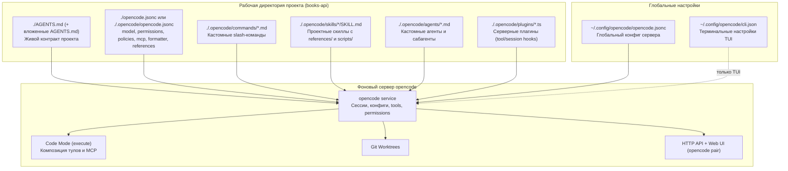
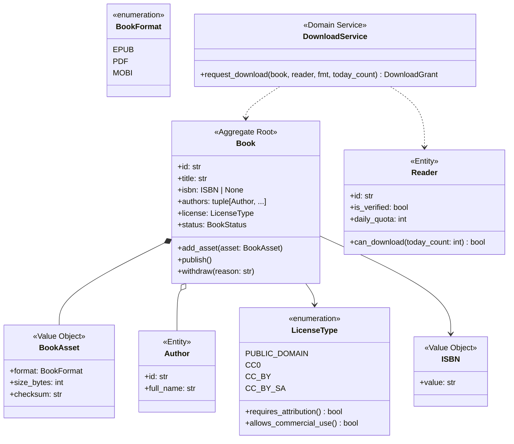

# Практический курс по OpenCode V2: от `AGENTS.md` до плагинов и headless-автоматизации

> [← К выбору трека и карте стенда](../README.md)

Этот курс состоит из **10 практических уроков**. Проходя их по порядку, вы освоите нативный workflow **OpenCode V2** и все ключевые **настройки уровня проекта** — от живого контракта `AGENTS.md` и декларативного `opencode.jsonc` до кастомных агентов, permissions/policies, параллельных сабагентов, worktrees, плагинов и headless-автоматизации.

В качестве тренировочного полигона мы с нуля построим доменное ядро учебного проекта **`books-api`** (каталог легальной бесплатной раздачи книг в открытом достоянии и под свободными лицензиями Creative Commons).

---

## Главный принцип курса

1. **Стартовое состояние репозитория чистое.** В `src/books_api/` сейчас лежит только заглушка `__init__.py`, а папки `.opencode/` и `justfile` ещё нет. Все проектные настройки, конвейер проверок (`ruff`, `ty`, `pytest`), команды, скиллы, MCP-серверы, плагины и модули домена вы создаёте по ходу уроков вместе с агентом.
2. **Домен намеренно компактный, а контур качества строгий.** Мы пишем только чистый Domain Layer на стандартной библиотеке Python 3.14 (`dataclasses`, `enum`, `typing.Protocol`), проверяем его максимально строгими и непротиворечивыми правилами `ruff` и `ty` и покрываем быстрыми тестами на `pytest` (через единые команды `just check` и `just test`). Никаких ORM, SQL и веб-серверов: фокус курса направлен на мастерство управления агентом и замкнутую обратную связь, а не на инфраструктурный бойлерплейт.
3. **Каждую фичу проверяем глазами.** В каждом уроке есть блок самопроверки через встроенные команды диагностики (`/agents`, `/mcps`, `/diff`, `opencode debug config`, `opencode debug agents`, `opencode mcp list`, `opencode stats`), чтобы вы точно понимали, как OpenCode устроен под капотом.

---

## Требования к окружению

Перед стартом проверьте в терминале:

```bash
opencode --version      # OpenCode V2 с подключённым провайдером (opencode auth list)
opencode service status # состояние фонового сервера OpenCode
uv --version            # менеджер окружения и пакетов Python
just --version          # раннер команд проекта (just check / just test)
python3 --version       # Python 3.14+
```

> **Совет:** держите открытыми два окна или две панели терминала в директории `books-api`. В первом окне у вас будет жить интерактивная TUI-сессия `opencode`, а во втором удобно запускать диагностические CLI-команды (`opencode debug ...`, `opencode mcp ...`, `opencode stats`, `git status`) и читать текст текущего урока.
> Либо попросите сам `opencode` открыть нужный урок: `Прочитай и кратко перескажи tutorial/opencode-lessons/01-workspace-tui-and-agents-md.md`.

---

## Как OpenCode V2 собирает настройки вокруг вашего проекта

OpenCode V2 построен по **клиент-серверной архитектуре**: TUI, `opencode mini`, Web UI и headless-CLI — это клиенты одного фонового сервера, который владеет сессиями, конфигурацией, инструментами и правами. Настройки декларативные и компонуемые, а изменения конфигов подхватываются «на лету», без перезапуска сессии.



> **Важные детали архитектуры OpenCode V2:**
> - `opencode.jsonc` — серверно-проектный конфиг (`model`, `permissions`, `policies`, `mcp`, `formatter`, `instructions`, `references`, плагины). Файл в `.opencode/opencode.jsonc` перекрывает корневой `opencode.jsonc`, а глобальный `~/.config/opencode/opencode.jsonc` — база.
> - `~/.config/opencode/cli.json` — настройки **только терминального клиента** (темы, keybinds, вкладки, диффы). Не смешивайте его с `opencode.jsonc`.
> - `AGENTS.md` подхватывается **живо**: правка файла обнаруживается до следующего запроса модели, без создания новой сессии.
> - В уроках мы разберём каждый из этих механизмов на практике.

---

## Целевая доменная область `books-api`

За 10 уроков в пакете `src/books_api/domain/` вырастет аккуратная модель каталога свободных электронных книг:



---

## Программа курса (10 уроков)

### Блок I. Базовый контур, конфигурация проекта и управление ходом в TUI

| № | Урок | Фичи OpenCode V2 | Что создаём в `books-api` |
|---|---|---|---|
| **01** | [Рабочее пространство, TUI и живой контракт `AGENTS.md`](01-workspace-tui-and-agents-md.md) | Клиент-серверная архитектура, палитра `Ctrl+P`, leader `Ctrl+X`, ссылки `@path`, shell-режим `!`, `/models`, `/agents`, live-обновление `AGENTS.md` | Корневой `AGENTS.md`, строгие `ruff` + `ty` + `pytest` в `pyproject.toml`, `justfile` (`just check`, `just test`), иерархия `DomainError` |
| **02** | [Конфигурация `opencode.jsonc` vs `cli.json`, варианты моделей, форматтеры и warming](02-project-config-models-and-formatters.md) | Иерархия конфигов, `{env:}` / `{file:}`, hot-reload, `provider/model#variant`, `formatter: true`, `warming`, `opencode stats` | Проектный `opencode.jsonc` (форматтер + `instructions`), Value Objects: `BookFormat`, `LanguageCode`, `ISBN`, `LicenseType` |
| **03** | [Plan-режим, steering, `/btw`, снапшоты `/undo` и ревью в `/diff`](03-plan-mode-steering-snapshots-and-diff.md) | Агенты `Plan`/`Build`, `experimental.todo`, Steering vs Queue, `Ctrl+B`, `/btw`, snapshots `/undo`/`/redo`, Diff Viewer (`turn`/`working`/`branch`, пометка `m`) | Сущности `Author`, `BookAsset` и агрегат `Book` с жизненным циклом публикации и отзыва |

### Блок II. Долговременный контекст, кастомные команды, скиллы и MCP

| № | Урок | Фичи OpenCode V2 | Что создаём в `books-api` |
|---|---|---|---|
| **04** | [Сессии, compaction, вложенные `AGENTS.md` и внешние `references`](04-sessions-compaction-nested-instructions-and-references.md) | `/new`, `/sessions`, вкладки, `session rename`, экспорт/импорт, `compaction` (`keep.tokens`, `buffer`), nested `AGENTS.md`, `references` | `src/books_api/domain/AGENTS.md`, подключение продуктовых спецификаций через `references`, сущность `Reader` с антибот-квотами |
| **05** | [Кастомные slash-команды и shell-инъекции `!`...``](05-custom-commands-and-shell-injection.md) | `.opencode/commands/*.md`, вложенные неймспейсы, `$ARGUMENTS` / `$1` / `$2`, `!`команда`` в шаблоне, frontmatter `agent`/`model`/`subagent` | Команды `/commit`, `/check-module`, `/explain-error` и первый атомарный коммит через собственную команду |
| **06** | [Проектные скиллы со справочниками и скриптами](06-project-skills-and-bundled-resources.md) | `.opencode/skills/<id>/SKILL.md`, приватные `references/` и `scripts/`, правила обнаружения, `opencode/autoinvoke`, `permissions` для `skill` | Скилл `domain-invariants` (чеклист + AST-скрипт чистоты) и укрепление граничных инвариантов `Book` и `Reader` |
| **07** | [Проектный MCP-сервер и Code Mode (`execute`)](07-mcp-servers-and-code-mode.md) | `mcp.servers` (`local`/`remote`), `{env:VAR}`, `opencode mcp add/list`, `/mcps`, Code Mode `codemode: true`, MCP-ресурсы | Локальный stdio MCP-сервер лицензий (`tools/license_mcp.py`) и модуль `LicensePolicy` (`build_license_notice`, `resolve_anthology_license`) |

### Блок III. Кастомные агенты, безопасность и параллельная мультиагентность

| № | Урок | Фичи OpenCode V2 | Что создаём в `books-api` |
|---|---|---|---|
| **08** | [Кастомные агенты, permissions/policies и независимое ревью](08-custom-agents-permissions-and-subagent-review.md) | `.opencode/agents/*.md` (`mode`, `model`, `steps`), `permissions` (allow/ask/deny), `policies` (`tool.use`, `provider.use`), read-only сабагент-ревьюер, `/review` с `subagent: true` | Защитные правила для `pip`, read-only агент `domain-reviewer`, `DownloadService` (`request_download`, `request_bundle`) и отлов краевых багов ревью |
| **09** | [Параллельные сабагенты и Git worktrees](09-parallel-subagents-and-worktrees.md) | Фоновые сабагенты (`sessionID`, `<subagent>`-уведомления), `subagent_depth`, `worktree.directory`, `worktree_create`/`worktree_list`/`worktree_remove`, `session_move` | Параллельная разработка `catalog.py` и `anthology.py`, изолированный эксперимент с ранжированием поиска в отдельном worktree |

### Блок IV. Расширение рантайма, автоматизация и мультиклиентский режим

| № | Урок | Фичи OpenCode V2 | Что создаём в `books-api` |
|---|---|---|---|
| **10** | [Плагины, headless CLI, HTTP API и Web UI](10-plugins-headless-cli-api-and-web.md) | `.opencode/plugins/*.ts` (`Plugin.define`), `ctx.tool.hook` / `ctx.permission.hook`, `opencode run` (`--agent`, `--format json`, `--archived`, `--auto`), `opencode api`, `opencode mini`, `opencode pair` | Плагин `domain-guard.ts`, финальная карта домена `docs/domain-architecture.md`, CI-скрипт `scripts/ci_domain_audit.sh` |

---

## Как проходить уроки

- Идите строго от **Урока 01** к **Уроку 10**: каждый следующий урок опирается на код `books-api` и настройки проекта, созданные в предыдущем.
- Не бойтесь экспериментировать с формулировками промптов: примеры промптов в уроках даны как ориентир, а команды `just check` и `just test` в конце каждого урока гарантируют, что ваш домен безупречно типизирован, отформатирован и остаётся в рабочем состоянии.
- В конце каждого урока фиксируйте прогресс коммитом (вручную или через собственную команду `/commit`, которую вы создадите в Уроке 05), чтобы в любой момент видеть чистый `git diff` следующего шага.

Готовы? Переходите к **[Уроку 01: Рабочее пространство, TUI и живой контракт `AGENTS.md`](01-workspace-tui-and-agents-md.md)**.
